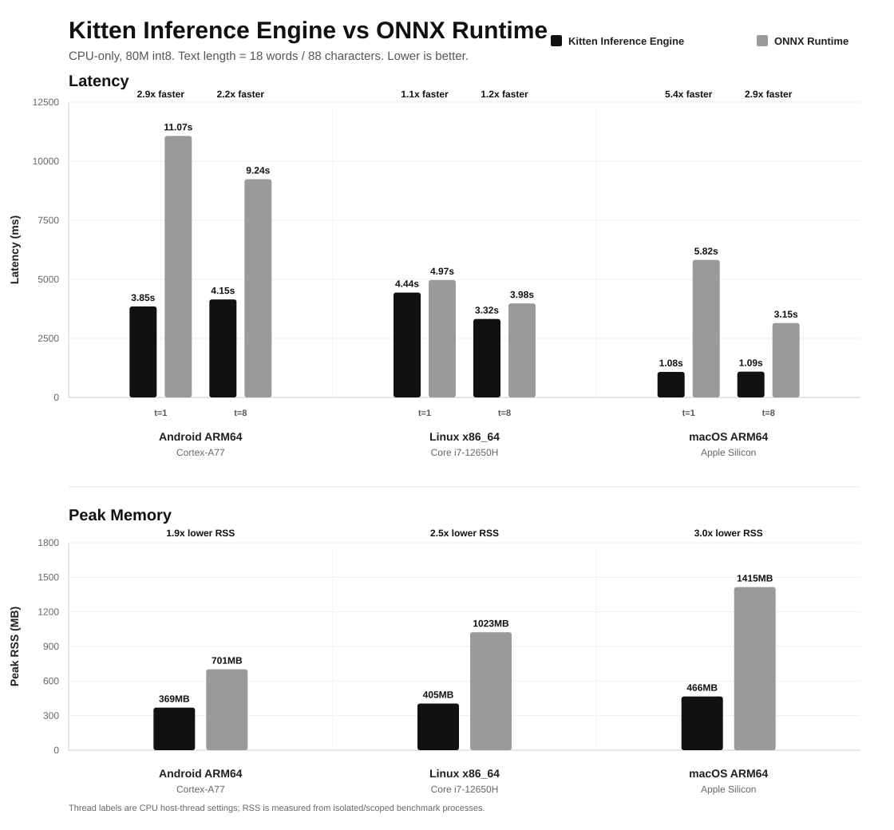

# kitten-inference

Fast, lightweight inference engines for KittenML's text-to-speech models, in one Python package. One
`pip install kitten-inference` runs every model with no PyTorch and nothing to compile, and picks the right engine
and hardware for each:

- **Kitten TTS 2**, the large expressive model, on NVIDIA and AMD GPUs.
- **Kitten TTS 2 mini, nano and pico**, small multilingual models (up to 16 languages), on the CPU and the Mac GPU.
- **Kitten TTS 0.8**, the small English model, on the CPU and the Mac GPU.

Every model uses the same Python API (`from kitten_inference import KittenTTS`) and command line (`kitten-tts`). The
same engines also build as a C library for Android and iOS apps, which takes text and returns audio on the phone
(English for Kitten TTS 0.8; English, Spanish and Italian for Kitten TTS 2 mini, nano and pico:
[engines/lite/mobile](https://github.com/KittenML/kitten-inference/blob/main/engines/lite/mobile/README.md)).

How it compares with the official packages:

|  | **Kitten TTS 2** on an NVIDIA GPU | **Kitten TTS 0.8** on the CPU | **Kitten TTS 2 mini, nano, pico** on the CPU |
|---|---|---|---|
| Key result | Complete files **5 to 7 times faster** than Kitten TTS 2 on vLLM or llama.cpp | The nano model **1.1 to 2.3 times faster** than kittenml 0.9.6 (ONNX Runtime) on Linux (x86-64 and ARM64), Windows x64 and Apple Silicon Macs | Mini **2.2 to 2.6 times faster** than kittenml 0.9.8 (ONNX Runtime int8), at full precision |
| Speed | First streamed audio after **about 11 ms** (vLLM and llama.cpp: 481 to 643 ms, as they stream whole sentences) | **About 60 times faster than real time** | Mini **13 to 16 times faster than real time** on 4 threads |
| Example | A short text in 82 ms and a long text in 0.95 s, against 453 to 584 ms and 4.9 to 6.6 s on vLLM, 520 ms and 5.4 s on llama.cpp | A 41-word text (15 to 17 s of speech) in 0.29 s, against 0.54 s with ONNX Runtime | 69 s of speech from mini in 4.2 s, against 9.3 s with ONNX Runtime |
| Measured on | RTX PRO 6000, one request at a time; vLLM through kittenml 0.9.6 | Ryzen 9 9900X (12 cores), default settings of both packages (on Apple Silicon this engine uses the GPU) | Ryzen 9 9900X and 5950X at 4 threads (Arm64 Cortex-X925: 2.0 times) |

On smaller GPUs the Kitten TTS 2 lead is smaller: first audio after 22 ms and complete files 4.5 to 6.9 times faster
on an RTX 4090, 58 ms and 2.4 to 4.3 times on a 12 GB RTX 3060. Word error rate on short texts is 0.02 to 0.05% for
every engine compared.





## Install

Every model uses `from kitten_inference import KittenTTS` with an explicit model name ([API](https://github.com/KittenML/kitten-inference/blob/main/docs/api.md)).

The commands below start a virtual environment and install support for all three model families. On Ubuntu and Debian, `python3 -m venv` needs
`sudo apt-get update && sudo apt-get install -y python3-venv` first. On Windows, run the blocks in a Command Prompt (in PowerShell, type `cmd` first), with `py -m venv .venv` and then
`.venv\Scripts\activate.bat` in place of the first line. On macOS, run the blocks in Terminal. A new Mac has no
Python 3: `python3` only opens a dialog that offers the developer tools (you can cancel it). Install Python 3.14 with
the "macOS 64-bit universal2 installer" from [python.org](https://www.python.org/downloads/macos/) (not 3.15, which
needs a C compiler for a dependency), then open a new Terminal window. In every new Terminal window, run
`. .venv/bin/activate` again in the same folder before `python` or `kitten-tts`.

### Kitten TTS 2: NVIDIA and AMD GPUs

```sh
python3 -m venv .venv && . .venv/bin/activate
python -m pip install -U pip
pip install kitten-inference
kitten-tts --model KittenML/kitten-tts-2 --text "Hello from Kitten TTS 2." --voice Bruno --output hello.wav
```

- NVIDIA GPU on Linux x86-64 (glibc 2.28 or newer: Ubuntu 20.04, Debian 10, RHEL 8 or later) or Windows x64, with driver R570 or newer.
- Python 3.9 to 3.14 (Python 3.15 needs a C compiler until PyYAML, a dependency, ships ready-made 3.15 packages).
  First use downloads the model (about 4.6 GB) and prepares it once, in about 1 to 3 minutes; later starts reuse it.
- **AMD Radeon RX 7000 and RX 9000:** supported inside WSL2 on Windows 11, experimental on Linux x86-64 without WSL2.
  Install ROCm 7 first (WSL2: step 1 of [AMD Radeon](https://github.com/KittenML/kitten-inference/blob/main/engines/tts2/docs/amd-radeon.md); Linux without WSL2:
  [AMD's ROCm guide](https://rocm.docs.amd.com/projects/install-on-linux/en/latest/) for your distribution), then
  run the same commands: the package finds the Radeon (on a PC that also has an NVIDIA GPU, add `--backend rocm`).
  Real-time factor about 0.06 on an RX 9070 XT (10 s of speech in about 0.6 s). No voice cloning on Radeon.
- **Voice cloning** (NVIDIA only) needs FFmpeg (`sudo apt-get update && sudo apt-get install -y ffmpeg`; on Windows
  `winget install --id Gyan.FFmpeg -e`, then open a new Command Prompt and activate the venv again; Windows Server
  2022 needs winget installed first) and about 11,300 MiB (11 GB) of free GPU memory while the voice is built: on a
  12 GB card, other programs may use at most about 500 MiB.
- **GeForce GTX 10, GTX 16 and RTX 20 series:** supported, not optimal: they have no bf16 tensor cores, so part of the
  math runs in software (real-time factor 0.22 to 0.37 for complete files on desktop cards with 6 GB or more, against
  0.05 to 0.08 on RTX 30, 40 and 50 series cards).
- **Without Python:** the engine is also a C library and the `kitten-tts-native` command. Build it with
  `git clone --branch v0.2.0 https://github.com/KittenML/kitten-inference.git`, then `cd kitten-inference/engines/tts2`, and
  follow [engines/tts2/README.md](https://github.com/KittenML/kitten-inference/blob/main/engines/tts2/README.md).

The package picks its memory settings from the free GPU memory ([GPU memory](https://github.com/KittenML/kitten-inference/blob/main/engines/tts2/docs/memory.md)):

| GPU memory | Built-in voices | Voice cloning |
|---|---|---|
| 24 GB or more | default profile: about 13,500 MiB with one voice | yes: about 15,600 MiB while a voice is built |
| 16 GB | default profile when it fits, else the low-memory profile | yes, with the low-memory profile: about 11,300 MiB |
| 12 GB | low-memory profile, about 9,100 MiB: supported, not optimal, because requests at the same time share smaller buffers (one at a time runs as fast: real-time factor 0.050 against 0.051 on a 16 GB card) | only with about 11,300 MiB free; 10 GB cards: no |
| 4 to 8 GB | low-memory profile fitted to the card: supported, not optimal (one request at a time; complete files about 1.5% slower) | no: build and save the voice on a larger GPU, then load it |

### Kitten TTS 0.8: the CPU

```sh
python3 -m venv .venv && . .venv/bin/activate
python -m pip install -U pip
pip install kitten-inference
python -c "from kitten_inference import KittenTTS; KittenTTS('KittenML/kitten-tts-nano-0.8').generate_to_file('Hello from Kitten TTS.', 'hello.wav', voice='Jasper')"
```

- Supported: Python 3.8 to 3.14 on Linux x86-64 and ARM64 and Windows x64, and Python 3.9 to 3.14 on Apple Silicon
  Macs (Python 3.15 needs a C compiler until PyYAML ships ready-made 3.15 packages; Python 3.8 on a Mac needs the
  developer tools, `xcode-select --install`, because cffi and PyYAML have no ready-made 3.8 packages for Apple
  Silicon). Experimental: Intel Macs (the macOS build uses one CPU core), Windows ARM64 (no ARM vector kernels, about
  9 times slower than Linux ARM64) and Android ARM64 ([platforms](https://github.com/KittenML/kitten-inference/blob/main/engines/lite/README.md#platforms)).
- On Windows, if `KittenTTS()` reports "espeak not installed", install the Microsoft Visual C++ Redistributable:
  `winget install Microsoft.VCRedist.2015+.x64`.
- On Windows, keep the virtual environment's path under about 150 characters; longer paths stop TTS 0.8 with an error
  that says so.
- **Supported, not optimal:**
  - int8 models on Intel CPUs: the int8 kernels for x86 are not tuned yet, so they take 1.2 to 2.2 times the ONNX
    Runtime time;
  - int8 models on Apple Silicon: the macOS build uses one CPU core, so they take 1.4 to 1.8 times the ONNX Runtime
    time;
  - creating a model again on the Mac GPU (Metal): each new `KittenTTS` keeps about 290 MB (nano) to 470 MB (mini)
    until the process ends, because the engine does not free its GPU copies of the weights yet. Create each model
    once and reuse it.

### Kitten TTS 2 mini, nano and pico: the CPU, the Mac GPU and NVIDIA GPUs

Three small multilingual models, from the same install as Kitten TTS 0.8. Nothing to compile, no extras.

| Model | Size | Download on first use | Languages |
|---|---|---|---|
| [KittenML/kitten-tts-2-mini](https://huggingface.co/KittenML/kitten-tts-2-mini) | 82M parameters, one model for all languages | about 330 MB once | 16: `en` `de` `es` `fr` `it` `pt` `ru` `hi` `da` `fi` `ja` `ko` `nl` `sv` `sw` `tr` |
| [KittenML/kitten-tts-2-nano](https://huggingface.co/KittenML/kitten-tts-2-nano) | 17M parameters per language | about 70 MB per language | 8: `en` `de` `es` `fr` `it` `pt` `ru` `hi` |
| [KittenML/kitten-tts-2-pico](https://huggingface.co/KittenML/kitten-tts-2-pico) | 7M parameters per language | about 30 MB per language | the same 8 |

English and Japanese need Python 3.10 to 3.14 (`python3 --version`; on an older one use, for example,
`python3.12 -m venv .venv`).

```sh
python3 -m venv .venv && . .venv/bin/activate
python -m pip install -U pip
pip install kitten-inference
python -c "from kitten_inference import KittenTTS; KittenTTS('KittenML/kitten-tts-2-nano').generate_to_file('Guten Morgen.', 'hallo.wav', language='de')"
python -c "from kitten_inference import KittenTTS; KittenTTS('KittenML/kitten-tts-2-nano').generate_to_file('Hello from Kitten TTS 2.', 'hello.wav')"
```

- **Precision:** float32 by default. `KittenTTS(model, precision="int8")` (or `--precision int8`) is smaller and faster
  on most Arm64 CPUs; on x86-64 keep float32 unless you run Linux on a CPU with AVX-512 VNNI.
- **Backend:** the CPU everywhere. On Apple Silicon Macs float32 runs on the Mac GPU by default; `backend="cpu"` keeps
  it on the CPU. `backend="cuda"` (`--backend cuda`) runs float32 on NVIDIA GPUs (Linux x86-64, NVIDIA driver R570 or newer).
- **Voices and speed:** each language has its own voices: `KittenTTS(model).list_voices(language="de")`; without
  `voice=` the language's first voice speaks. `speed=` goes from 0.25 to 4.
- **First use** downloads the official files from Hugging Face and converts them once (a few seconds) into the cache;
  on a read-only system pass `cache_dir=` with a writable folder. Japanese (mini only) also downloads a 47 MB
  dictionary once.
- **Threads:** one per logical CPU on Linux and Windows (set `OMP_NUM_THREADS` to use fewer); one core on macOS.
- **Memory:** `low_memory=True` (`--low-memory`) uses the least memory on the CPU, at some cost in speed: mini needs
  0.6 to 0.7 GB instead of 0.77 to 0.92 GB (short to long text).
- **Command line:** `kitten-tts --model KittenML/kitten-tts-2-nano --text "Guten Morgen." --language de --output hallo.wav`.
- **Requirements:** x86-64 CPUs need AVX2 and FMA; Linux Arm64 CPUs need the dot-product instructions (Raspberry Pi 5
  yes, Pi 4 no); Linux needs glibc 2.29 or newer; Japanese is not available on Windows on Arm. The package says so
  when something is missing.

Speed, memory, int8 and server numbers: [engine README](https://github.com/KittenML/kitten-inference/blob/main/engines/lite/README.md#kitten-tts-2-mini-nano-and-pico).

## Use from Python

```python
from kitten_inference import KittenTTS

tts = KittenTTS("KittenML/kitten-tts-2")
tts.save_wav("hello.wav", tts.generate("Hello from Kitten TTS 2.", voice="Bruno"))
for chunk in tts.stream("Streaming speech, chunk by chunk.", voice="Bruno"):
    ...
```

```python
from kitten_inference import KittenTTS

KittenTTS("KittenML/kitten-tts-nano-0.8").generate_to_file("Hello from Kitten TTS.", "hello.wav", voice="Jasper")
```

```python
from kitten_inference import KittenTTS

with KittenTTS("KittenML/kitten-tts-2-mini") as tts:
    print(tts.list_voices(language="fr"))
    tts.generate_to_file("Bonjour, comment allez-vous ?", "bonjour.wav", language="fr")
```

## Docs

- [Python API and `kitten-tts` command](https://github.com/KittenML/kitten-inference/blob/main/docs/api.md): voices, streaming, voice
  cloning, saved voices, and model options.
- [Kitten TTS 2 engine](https://github.com/KittenML/kitten-inference/blob/main/engines/tts2/README.md): speed tables, [supported GPUs](https://github.com/KittenML/kitten-inference/blob/main/engines/tts2/README.md#supported-gpus), building
  from source, the command-line tool and the C API. Also: [Windows](https://github.com/KittenML/kitten-inference/blob/main/engines/tts2/docs/windows.md),
  [AMD Radeon](https://github.com/KittenML/kitten-inference/blob/main/engines/tts2/docs/amd-radeon.md), [GPU memory](https://github.com/KittenML/kitten-inference/blob/main/engines/tts2/docs/memory.md),
  [speed and audio by GPU group](https://github.com/KittenML/kitten-inference/blob/main/engines/tts2/docs/consumer-gpus.md).
- [Kitten TTS 0.8](https://github.com/KittenML/kitten-inference/blob/main/engines/lite/README.md): models and voices, options, platforms, and upgrading from 0.1.x
  (`import model_inference` needs `kitten-inference==0.1.1`).
- Kitten TTS 2 mini, nano and pico: [this README's section](#kitten-tts-2-mini-nano-and-pico-the-cpu-the-mac-gpu-and-nvidia-gpus) and the
  [Python API](https://github.com/KittenML/kitten-inference/blob/main/docs/api.md#model-specific-operations); on phones, the C library in
  [engines/lite/mobile](https://github.com/KittenML/kitten-inference/blob/main/engines/lite/mobile/README.md), which can also use the NPU of Snapdragon phones
  ([optional](https://github.com/KittenML/kitten-inference/blob/main/engines/lite/mobile/README.md#qualcomm-npu-optional)).

## License

KittenML's code is Apache-2.0 ([LICENSE](https://github.com/KittenML/kitten-inference/blob/main/LICENSE)); the package also contains third-party code under other licences
([NOTICE](https://github.com/KittenML/kitten-inference/blob/main/NOTICE), [engines/tts2/NOTICE](https://github.com/KittenML/kitten-inference/blob/main/engines/tts2/NOTICE), [engines/lite/NOTICE](https://github.com/KittenML/kitten-inference/blob/main/engines/lite/NOTICE)). The models download on first use and keep their publishers' licences. The Kitten TTS 2 model is
under the [Stellon Labs Community License](https://huggingface.co/KittenML/kitten-tts-2/blob/main/LICENSE.md), not
Apache or MIT: it limits commercial use, training on the outputs and redistribution, so read it before you build on
Kitten TTS 2. The Kitten TTS 0.8 model licences are in [engines/lite/README.md](https://github.com/KittenML/kitten-inference/blob/main/engines/lite/README.md#license). The Kitten TTS 2
mini, nano and pico models are Apache-2.0 (see their Hugging Face pages).
