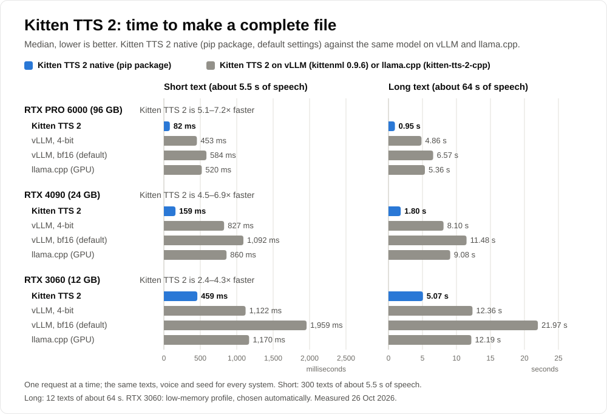
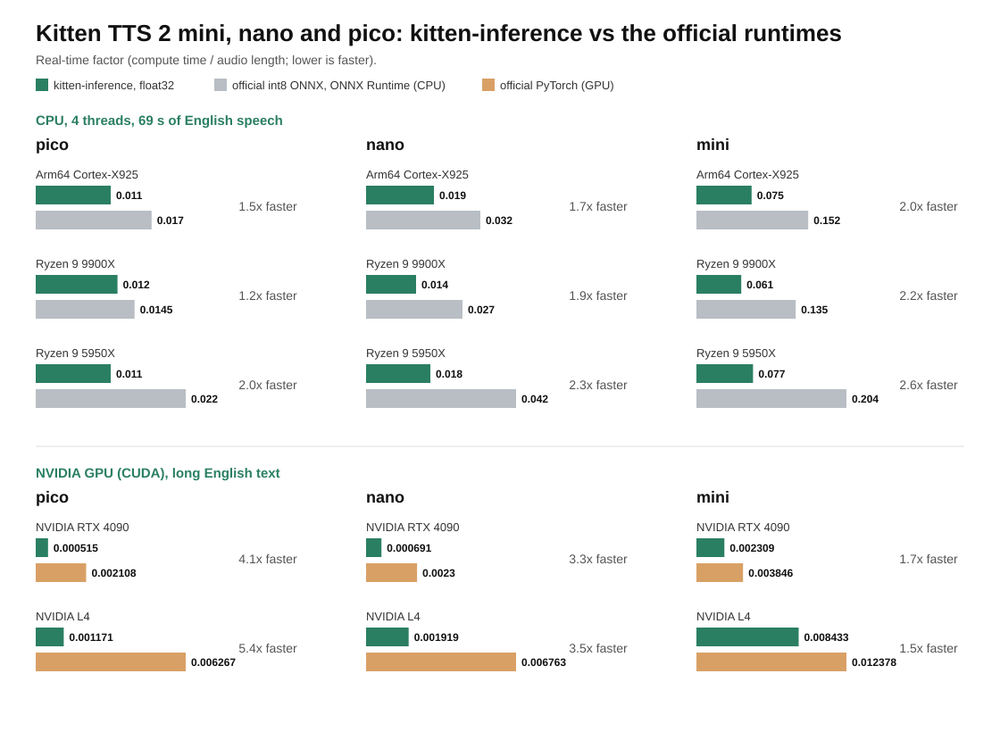

# kitten-inference

Fast, lightweight inference engines for KittenML's text-to-speech and speech-to-text
models, in one Python package. One
`pip install kitten-inference` runs every model with no PyTorch and nothing to compile, and picks the engine and
hardware for each.

| Model | Runs on | Speed |
|---|---|---|
| Kitten TTS 2 | NVIDIA and AMD GPUs | complete files 5 to 7 times faster than on vLLM or llama.cpp on an RTX PRO 6000 (2.4 times or more on an RTX 3060) |
| Kitten TTS 2 mini, nano and pico (up to 16 languages) | the CPU, the Mac GPU and NVIDIA GPUs | mini 2.0 to 2.6 times faster than kittenml (ONNX Runtime int8) |
| Kitten TTS 0.8 (English) | the CPU and the Mac GPU | nano 1.1 to 2.3 times faster than kittenml (ONNX Runtime) |
| Kitten ASR tiny and small-enhanced (speech to text, up to 30 languages) | NVIDIA GPUs, the CPU and the Mac GPU | tiny 26 times faster than real time on a 32-thread CPU |






The Kitten TTS 0.8 chart is the 80M int8 model on the CPU only (the table's numbers are nano, on the Mac GPU on Macs).
More numbers: [Kitten TTS 2](https://github.com/KittenML/kitten-inference/blob/main/engines/tts2/README.md#performance),
[mini, nano and pico](https://github.com/KittenML/kitten-inference/blob/main/engines/lite/README.md#kitten-tts-2-mini-nano-and-pico), [Kitten TTS 0.8](https://github.com/KittenML/kitten-inference/blob/main/engines/lite/README.md).

The small models also build as a C library for Android and iOS apps
([engines/lite/mobile](https://github.com/KittenML/kitten-inference/blob/main/engines/lite/mobile/README.md)).

## Install

```sh
python3 -m venv .venv && . .venv/bin/activate
python -m pip install -U pip
pip install kitten-inference
```

- On Ubuntu and Debian, `python3 -m venv` needs `sudo apt-get update && sudo apt-get install -y python3-venv` first.
- On Windows, run the commands in a Command Prompt (in PowerShell, type `cmd` first), with `py -m venv .venv` and then
  `.venv\Scripts\activate.bat` in place of the first line. Windows guides for [TTS 2 mini, nano and pico](engines/lite/docs/windows.md) and [Kitten ASR](engines/asr/docs/windows.md).
- On macOS, a new Mac has no Python 3: install Python 3.14 with the "macOS 64-bit universal2 installer" from
  [python.org](https://www.python.org/downloads/macos/), then open a new Terminal window.

What each model needs (GPU, driver, Python version): [Kitten TTS 2](https://github.com/KittenML/kitten-inference/blob/main/engines/tts2/README.md#install-with-pip),
[mini, nano and pico](https://github.com/KittenML/kitten-inference/blob/main/engines/lite/README.md#kitten-tts-2-mini-nano-and-pico),
[Kitten TTS 0.8](https://github.com/KittenML/kitten-inference/blob/main/engines/lite/README.md#platforms), [Kitten ASR](https://github.com/KittenML/kitten-inference/blob/main/engines/asr/README.md#install).

## Use

```sh
kitten-tts --model KittenML/kitten-tts-2 --text "Hello from Kitten TTS 2." --voice Bruno --output hello.wav
kitten-tts --model KittenML/kitten-tts-2-nano --text "Guten Morgen." --language de --output hallo.wav
kitten-tts --model KittenML/kitten-tts-nano-0.8 --text "Hello from Kitten TTS." --voice Jasper --output hello.wav
kitten-asr --model KittenML/kitten-asr-tiny hello.wav
```

```python
from kitten_inference import KittenTTS

with KittenTTS("KittenML/kitten-tts-2-mini") as tts:
    tts.generate_to_file("Bonjour, comment allez-vous ?", "bonjour.wav", language="fr")
    for chunk in tts.stream("Streaming speech, chunk by chunk."):
        ...
```

```python
from kitten_inference import KittenASR

asr = KittenASR("KittenML/kitten-asr-tiny")     # an NVIDIA GPU when it can use one, otherwise the CPU
print(asr.transcribe("hello.wav"))
```

`kitten-asr` transcribes the `hello.wav` that the line before it made. The first use of a model downloads it from
Hugging Face. Within a model family, the options and errors are the same on every computer ([same behaviour on every hardware](https://github.com/KittenML/kitten-inference/blob/main/docs/api.md#same-behaviour-on-every-hardware)).

## Docs

- [Python API and `kitten-tts` command](https://github.com/KittenML/kitten-inference/blob/main/docs/api.md): voices, streaming, voice cloning, saved voices, and model
  options.
- [Kitten TTS 2](https://github.com/KittenML/kitten-inference/blob/main/engines/tts2/README.md): requirements, speed, [supported GPUs](https://github.com/KittenML/kitten-inference/blob/main/engines/tts2/README.md#supported-gpus),
  GPU memory, building from source, the C API. Also: [Windows](https://github.com/KittenML/kitten-inference/blob/main/engines/tts2/docs/windows.md),
  [AMD Radeon](https://github.com/KittenML/kitten-inference/blob/main/engines/tts2/docs/amd-radeon.md), [GPU memory](https://github.com/KittenML/kitten-inference/blob/main/engines/tts2/docs/memory.md),
  [speed and audio by GPU group](https://github.com/KittenML/kitten-inference/blob/main/engines/tts2/docs/consumer-gpus.md).
- [Kitten TTS 2 mini, nano and pico](https://github.com/KittenML/kitten-inference/blob/main/engines/lite/README.md#kitten-tts-2-mini-nano-and-pico): languages, options,
  speed and memory; on phones, [engines/lite/mobile](https://github.com/KittenML/kitten-inference/blob/main/engines/lite/mobile/README.md), which can also use the NPU of
  Snapdragon phones.
- [Kitten TTS 0.8](https://github.com/KittenML/kitten-inference/blob/main/engines/lite/README.md): speed, models and voices, options, platforms, and upgrading from 0.1.x
  (`import model_inference` needs `kitten-inference==0.1.1`).
- [Kitten ASR](https://github.com/KittenML/kitten-inference/blob/main/engines/asr/README.md): backends and precisions, speed, several files at once, live audio,
  the `kitten-asr` command, and the engine for servers.

## License

KittenML's code is Apache-2.0 ([LICENSE](https://github.com/KittenML/kitten-inference/blob/main/LICENSE)); the package also contains third-party code under other licences
([NOTICE](https://github.com/KittenML/kitten-inference/blob/main/NOTICE), [engines/tts2/NOTICE](https://github.com/KittenML/kitten-inference/blob/main/engines/tts2/NOTICE), [engines/lite/NOTICE](https://github.com/KittenML/kitten-inference/blob/main/engines/lite/NOTICE), [engines/asr/NOTICE](https://github.com/KittenML/kitten-inference/blob/main/engines/asr/NOTICE)). The models download on first use and keep their publishers' licences. The Kitten TTS 2 model is
under the [Stellon Labs Community License](https://huggingface.co/KittenML/kitten-tts-2/blob/main/LICENSE.md), not
Apache or MIT: it limits commercial use, training on the outputs and redistribution, so read it before you build on
Kitten TTS 2. The Kitten TTS 0.8 model licences are in [engines/lite/README.md](https://github.com/KittenML/kitten-inference/blob/main/engines/lite/README.md#license). The Kitten TTS 2
mini, nano and pico models are Apache-2.0 (see their Hugging Face pages).
