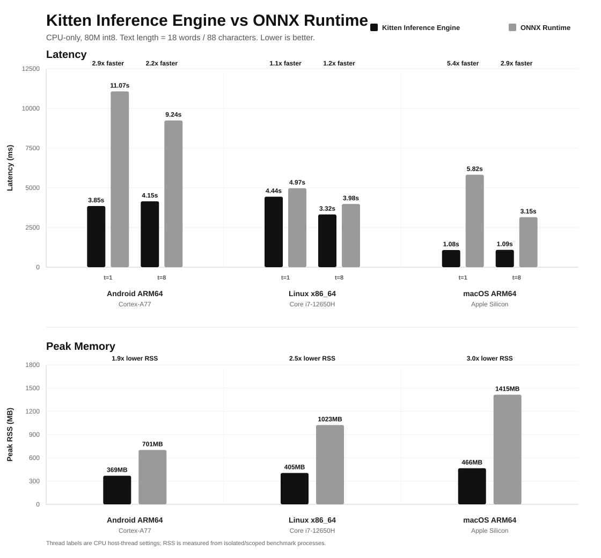
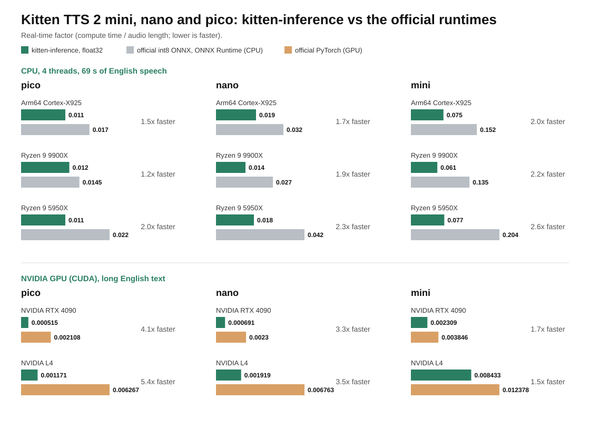

# Kitten TTS 0.8 and Kitten TTS 2 mini, nano and pico

Small, fast text-to-speech on a native C++ engine. Kitten TTS 0.8: three English models from 15M to 80M parameters,
eight voices, 24 kHz audio. Kitten TTS 2 mini, nano and pico: [below](#kitten-tts-2-mini-nano-and-pico).

**The nano model speaks about 60 times faster than real time on a 12-core desktop CPU, and 1.1 to 2.3 times
faster than kittenml 0.9.6 (ONNX Runtime) on Linux (x86-64 and ARM64), Windows x64 and Apple Silicon Macs.** On
Linux x86-64 and Windows x64 it also uses 3 to 42% less memory than kittenml.

A 41-word text (15 to 17 s of speech) takes nano 0.29 s against 0.54 s on a Ryzen 9 9900X, and 0.37 s against
0.71 s on an Apple M4, where this engine uses the GPU (Metal) and ONNX Runtime the CPU. Both packages at default
settings on the same machine, median of 10 calls.



The chart is a separate measurement: the 80M int8 model, an 18-word text, CPU only on every machine (the Mac too),
at 1 and 8 threads.

## Install

```bash
python3 -m venv .venv && . .venv/bin/activate
python -m pip install -U pip
pip install "kitten-inference"
```

- On Windows, run the commands in a Command Prompt (in PowerShell, type `cmd` first), with `py -m venv .venv` and then `.venv\Scripts\activate.bat` in place of the first line.
- On Ubuntu and Debian, `python3 -m venv` needs `sudo apt-get update && sudo apt-get install -y python3-venv` first.

## Use

```python
from kitten_inference import KittenTTS

tts = KittenTTS("KittenML/kitten-tts-mini-0.8")
audio = tts.generate("This high-quality voice runs without a GPU.", voice="Jasper")
tts.generate_to_file("Hello, world.", "hello.wav", voice="Luna", speed=1.2)
```

The first use of a model downloads it from Hugging Face; later uses load it from the local cache.

## Models and voices

| Model | Parameters | Download |
|---|---|---|
| `KittenML/kitten-tts-mini-0.8` | 80M | 293 MB |
| `KittenML/kitten-tts-micro-0.8` | 40M | 140 MB |
| `KittenML/kitten-tts-nano-0.8` | 15M | 56 MB |

Add `-int8` to a name, for example `KittenML/kitten-tts-nano-0.8-int8`, for the smaller int8 weights
(116, 71 and 19 MB). They are usually faster than kittenml on AMD CPUs and on Linux ARM64. Apple Silicon runs them
on the CPU by default; on Metal they are about 5 times slower.

- int8 on Intel CPUs: supported, not optimal, because the int8 kernels for x86 are not tuned yet (1.2 to 2.2 times
  the kittenml time).
- int8 on the Mac CPU: supported, not optimal, because the macOS build uses one CPU core (1.4 to 1.8 times the
  kittenml time on an Apple M4).

Voices: Bella, Jasper, Luna, Bruno, Rosie, Hugo, Kiki and Leo (`tts.list_voices()`).

Options:
- `speed`: 1.0 is normal, higher is faster.
- `normalize=True`: spells out numbers, currencies and units before speaking.
- `tts.stream(text, voice=...)`: yields the audio one sentence at a time.
- `KittenTTS(..., backend="cpu")` or `"metal"`: by default Apple Silicon uses Metal for the full-size
  models and the CPU for the int8 models. On the CPU, models in different threads generate at the same
  time; one model shared by several threads runs their calls one at a time, and Metal runs one call at a time.
- On Metal, create each model once and reuse it. Creating it again is supported, not optimal, because the engine
  does not free its GPU copy of the weights yet: every new `KittenTTS` keeps about 290 MB (nano) to 470 MB (mini)
  until the process ends. The CPU backend frees it.

Audio can differ slightly between Metal and the CPU (clip lengths within about 3.5%), between CPU types, and with
the number of CPU threads (`OMP_NUM_THREADS`).

## Platforms

| Platform | Python | Status |
|---|---|---|
| Linux x86_64 and ARM64 | 3.8–3.14 | Supported |
| Windows x64 | 3.8–3.14 | Supported |
| macOS Apple Silicon | 3.8–3.14 | Supported |
| macOS Intel | 3.8–3.14 | Experimental |
| Windows ARM64 | 3.11–3.14 | Experimental; about 9 times slower than Linux ARM64 |
| Android ARM64 | 3.13 | Experimental |
| Android and iOS apps (C library, no Python) | – | See [mobile/README.md](mobile/README.md) |

- Python 3.15 needs a C compiler until PyYAML, a dependency, ships ready-made 3.15 packages.
- Python 3.8 on a Mac needs the developer tools (`xcode-select --install`), because cffi and PyYAML have no
  ready-made 3.8 packages for Apple Silicon.
- Linux needs glibc 2.29 or newer (Ubuntu 20.04, Debian 11, RHEL 9 or later); macOS needs version 11 or newer.
- The CPU needs AVX2 on x86-64, or dot-product instructions on ARM64 (a Raspberry Pi 5 works, a Raspberry Pi 4 does not).
- On Windows, keep the virtual environment's path under about 150 characters. If `KittenTTS()` reports "espeak not
  installed", install the Microsoft Visual C++ Redistributable: `winget install Microsoft.VCRedist.2015+.x64`.

## Kitten TTS 2 mini, nano and pico

Three small multilingual models, from the same install as Kitten TTS 0.8. Nothing to compile, no extras.

| Model | Size | Download on first use | Languages |
|---|---|---|---|
| [KittenML/kitten-tts-2-mini](https://huggingface.co/KittenML/kitten-tts-2-mini) | 82M parameters, one model for all languages | about 330 MB once | 16: `en` `de` `es` `fr` `it` `pt` `ru` `hi` `da` `fi` `ja` `ko` `nl` `sv` `sw` `tr` |
| [KittenML/kitten-tts-2-nano](https://huggingface.co/KittenML/kitten-tts-2-nano) | 17M parameters per language | about 70 MB per language | 8: `en` `de` `es` `fr` `it` `pt` `ru` `hi` |
| [KittenML/kitten-tts-2-pico](https://huggingface.co/KittenML/kitten-tts-2-pico) | 7M parameters per language | about 30 MB per language | the same 8 |

```python
from kitten_inference import KittenTTS

with KittenTTS("KittenML/kitten-tts-2-nano") as tts:
    tts.generate_to_file("Guten Morgen.", "hallo.wav", language="de")
```

Command line: `kitten-tts --model KittenML/kitten-tts-2-nano --text "Guten Morgen." --language de --output hallo.wav`.

- **Requirements:** English and Japanese need Python 3.10 to 3.14 (on an older one use, for example,
  `python3.12 -m venv .venv`). x86-64 CPUs need AVX2 and FMA; Linux Arm64 CPUs need the dot-product instructions
  (Raspberry Pi 5 yes, Pi 4 no); Linux needs glibc 2.29 or newer; Japanese is not available on Windows on Arm. The
  package says so when something is missing.
- **Precision:** float32 by default. `KittenTTS(model, precision="int8")` (or `--precision int8`) is smaller and
  faster on most Arm64 CPUs; on x86-64 keep float32 unless you run Linux on a CPU with AVX-512 VNNI.
- **Backend:** the CPU everywhere. On Apple Silicon Macs float32 runs on the Mac GPU by default; `backend="cpu"`
  keeps it on the CPU, which uses one core there: supported, not optimal. `backend="cuda"` (`--backend cuda`) runs
  float32 on NVIDIA GPUs on Linux x86-64 and [Windows x64](docs/windows.md#nvidia-gpu) (Python 3.9 or newer,
  NVIDIA driver R570 or newer).
- **Voices and speed:** each language has its own voices: `KittenTTS(model).list_voices(language="de")`; without
  `voice=` the language's first voice speaks. `speed=` goes from 0.25 to 4.
- **First use** downloads the official files from Hugging Face and converts them once (a few seconds) into the
  cache; on a read-only system pass `cache_dir=` with a writable folder. Japanese (mini only) also downloads a 47 MB
  dictionary once.
- **Threads:** one per logical CPU on Linux and Windows (set `OMP_NUM_THREADS` to use fewer).
- **Memory:** `low_memory=True` (`--low-memory`) uses the least memory on the CPU, at some cost in speed (numbers
  below).

Numbers below are real-time factors (RTF: compute time / audio length; lower is faster).



**CPU speed**, float32, 4 threads, four English texts (69 s of speech), against the official int8 ONNX files with
kittenml 0.9.8 (ONNX Runtime):

| CPU | pico | nano | mini |
|---|---|---|---|
| Arm64 (Cortex-X925) | 0.011 (ONNX 0.017) | 0.019 (ONNX 0.032) | 0.075 (ONNX 0.152) |
| x86-64, Ryzen 9 9900X (Zen 5) | 0.010-0.014 (ONNX 0.014-0.015) | 0.014 (ONNX 0.027) | 0.061 (ONNX 0.135) |
| x86-64, Ryzen 9 5950X (Zen 3) | 0.011 (ONNX 0.022) | 0.018 (ONNX 0.042) | 0.077 (ONNX 0.204) |

**Memory** (peak of a whole Python process in MiB, English, Ryzen 9 7950X X3D; two sentences to a 42 s text; the
thread count makes no difference): pico 288 to 355, nano 350 to 422, mini 770 to 917. Python with the English text
front end is about 237 of that. With `low_memory=True`: 261 to 285, 307 to 346 and 602 to 690, for 7 to 11% more
time (pico), about 15% (nano) and 1.7 times the time (mini, still 9 times faster than real time); its audio differs
from the default by rounding only. The first use also converts the weights once, which briefly needs about 450 MiB
more for mini.

**Mac GPU** (Apple M6, float32): RTF 0.014, 0.035 and 0.074 (pico, nano, mini), 1.5 to 3.4 times faster than the
CPU, which uses one core on macOS (RTF 0.027, 0.053 and 0.25).

**NVIDIA GPU** (`backend="cuda"`, float32, a 10 s English text): RTF on the GPU, then this engine on the CPU (16
threads, 14 on the L4 host) and the official PyTorch model (kittenml 0.9.8, PyTorch 2.9.1 defaults) on the same GPU:

| GPU (host CPU) | pico | nano | mini |
|---|---|---|---|
| RTX 4090 (Ryzen 9 7950X) | 0.0006 (CPU 0.0051, PyTorch 0.0021) | 0.0008 (0.0070, 0.0022) | 0.0024 (0.026, 0.0038) |
| L4 (Core Ultra 5 245K) | 0.0010 (0.011, 0.0024) | 0.0016 (0.014, 0.0027) | 0.0081 (0.059, 0.0082) |
| A100 40 GB (EPYC 7402P) | 0.0013 (0.010, 0.0047) | 0.0017 (0.016, 0.0047) | 0.0060 (0.049, 0.0070) |

The first sentence's audio is ready 1.8 to 3.8 times sooner than with PyTorch for pico and nano. Mini on the L4 is as
fast as PyTorch (0.97 to 1.05 times its time), which uses TF32 tensor cores there; this engine stays in float32. GPU
and CPU audio have the same length but are not bit-identical, as with PyTorch's own CPU and GPU results.

**int8:** faster on Arm64 (RTF 0.008, 0.012 and 0.048 at 4 threads) and smaller, with slightly lower quality. On
x86-64 it is slower than float32 unless the CPU has AVX-512 VNNI (Linux; for example AMD Zen 4, where it is 1.1 to
1.4 times faster).

**Many streams on one server.** A stream is one independent synthesis job, such as one user's request; a server
runs many at once. Measured on 2 x Xeon Silver 4110 (16 cores, 32 threads), float32, one process per stream:

| Model | Layout (streams x threads) | Audio s per wall s | Slowest stream's real-time factor |
|---|---|---|---|
| mini | 16 x 1 (16 physical cores) | 20.9 | 0.78 |
| mini | 8 x 2 (16 physical cores) | 20.3 | 0.40 |
| nano | 32 x 1 | 92.7 | 0.35 |
| nano | 16 x 1 (16 physical cores) | 86.1 | 0.19 |
| pico | 32 x 1 | 179.9 | 0.18 |
| pico | 16 x 1 (16 physical cores) | 164.4 | 0.10 |

Running one stream per physical core gave the most audio per second. Extra threads per stream lower one stream's
latency but not the total. Measure on your own CPU before choosing a layout.

## Environment variables

The engine reads only these, in every build. None is needed for normal use.

| Variable | Effect |
|---|---|
| `KITTEN_X86_ISA=avx2` | x86-64 Linux: use the AVX2 int8 kernels even on a CPU with AVX-512 VNNI. Slower; int8 audio changes slightly, float32 audio does not. |
| `KITTEN_ARM_ISA=v80`, `dotprod` or `i8mm` | Android: use at most this instruction set for the int8 kernels. |
| `KITTEN_ACCEL_SGEMM=0` or `1` | Apple builds with Accelerate: turn the Accelerate matrix route off or on ([mobile/README.md](mobile/README.md)). |
| `KITTEN_WEIGHTS_MMAP=0` or `1` | Read the weights file into memory (`0`) or map it (`1`). Default: mapped on Linux and Android, read on Apple. |
| `KITTEN_FP32_CONV1D_DIRECT=1` | Direct convolution instead of Winograd: less memory, slower. Same audio up to rounding. |
| `KITTEN_TTS08_VERBOSE=1` | Print what the engine chose at load time. |

The tests use `KITTEN_TTS08_PHONE_DEFAULTS`, `KITTEN_TTS08_CPUINFO` and `KITTEN_TTS08_SYS_ROOT` to imitate a phone's
CPU. The engine's development switches (kernel A/B toggles, statistics, profiles) work only in a build configured with
`-DKITTEN_ENGINE_DEV_ENV=ON`.

## Upgrading from kitten-inference 0.1.x

Version 0.2 replaces the `model_inference` module with `kitten_inference.KittenTTS`. Code that runs
`import model_inference` keeps working only with 0.1.1: pin `kitten-inference==0.1.1`.

## License

The code is licensed under Apache-2.0. The Kitten TTS 0.8 engine also contains third-party code under its own
licences (MIT, BSD-3-Clause, GPL-3.0-or-later with the GCC Runtime Library Exception, Apache-2.0 with LLVM
exceptions, and the Microsoft Visual C++ runtime terms): see
[NOTICE](https://github.com/KittenML/kitten-inference/blob/main/engines/lite/NOTICE), which each wheel also
carries in its `.dist-info/licenses/engines/lite/` folder. The same wheels also hold Kitten TTS 2, whose third-party
code is listed in [engines/tts2/NOTICE](https://github.com/KittenML/kitten-inference/blob/main/engines/tts2/NOTICE).

The models are the Kitten TTS 0.8 models, which KittenML publishes under Apache-2.0
([nano](https://huggingface.co/KittenML/kitten-tts-nano-0.8),
[micro](https://huggingface.co/KittenML/kitten-tts-micro-0.8),
[mini](https://huggingface.co/KittenML/kitten-tts-mini-0.8)); this package downloads them converted to its
engine's format from [KittenML/meownn-models](https://huggingface.co/KittenML/meownn-models). Kitten TTS 2 mini, nano
and pico download from their Hugging Face pages and keep the licence stated there.
